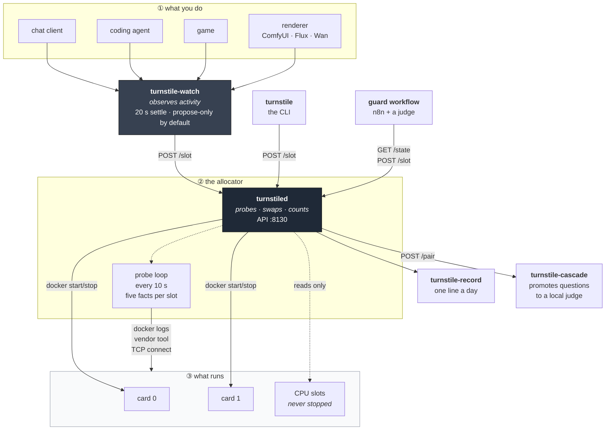
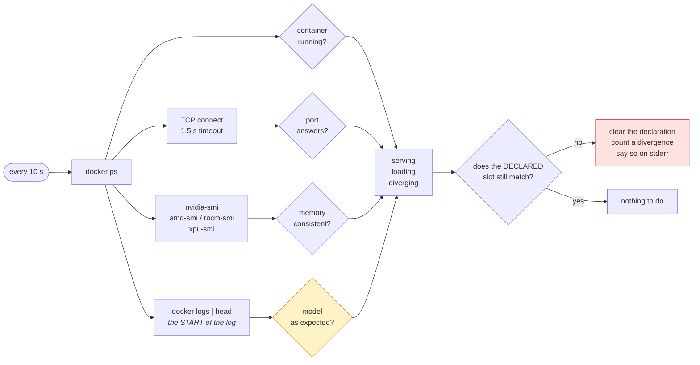
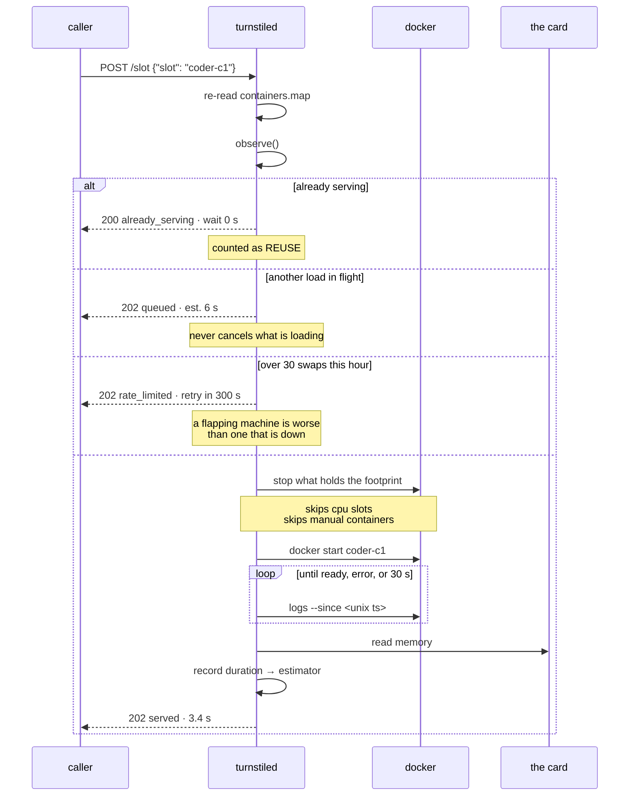
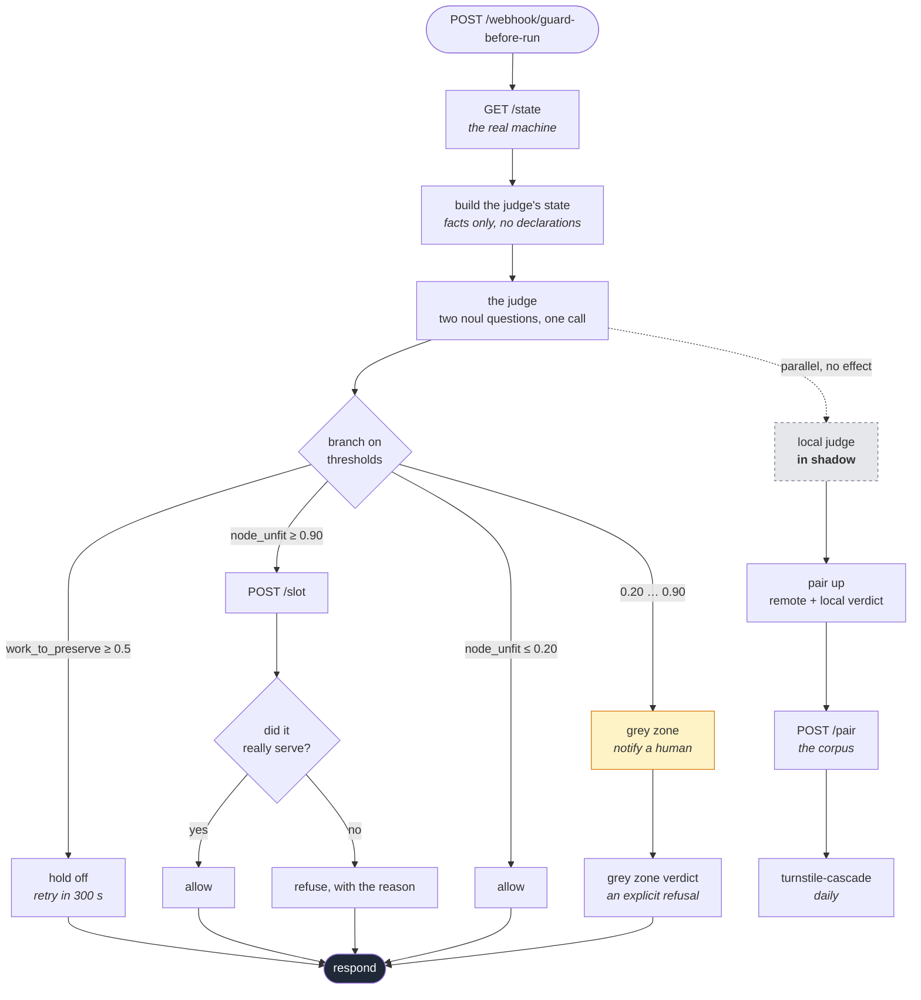
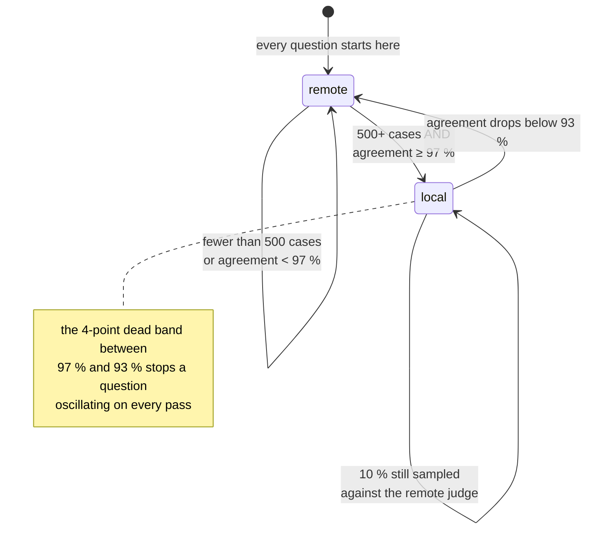

# The chain

How the pieces fit, what each one is allowed to decide, and where the
boundaries are.

---

## The whole thing, at a glance

---

## Who is allowed to decide what

This is the part worth being strict about. Two things deciding the same
question is the failure mode the whole project exists to remove.

| Component | Decides | Never does |
|---|---|---|
| `turnstiled` | which container runs on which card, right now | interpret what your work *means* |
| `turnstile` (CLI) | **nothing** — it calls and prints | hold a fallback code path |
| `turnstile-watch` | which slot to *ask for*, given observed activity | act at all, unless given `--act` |
| the guard workflow | whether a job may be dropped | launch the job itself |
| `turnstile-cascade` | which question a local judge may answer | change any live decision on its own |
| ComfyUI, a game, a render | their own card, held by hand | ask permission — they are *seen*, not driven |

**The CLI holds no logic on purpose.** An earlier version had the swap
logic in the shell script and the service beside it. That is two deciders
and no authority — exactly the problem being solved. So the script calls,
and prints.

---

## The probe is the foundation, not the swapping

Everything else rests on this loop. If it is wrong, every layer above it is
confidently wrong.

Two details that cost real time to find:

**The log is read from its BEGINNING, not its tail.** A `--tail` loses the
startup lines as soon as a server has been up a few hours — a model up for
13 hours reported as "diverging" while it was serving perfectly. The model
name and the granted context are written once, at startup, and never change.

**During a swap, the log is read from the swap's own start instant.**
`docker logs` returns the whole history: on a container's second start, the
previous run's "listening on" is already there, and a loop looking for it
concludes in 0.0 s having waited for nothing. And the `--since` value must
be a Unix timestamp — a bare date is read in local time, which on a machine
in CEST silently requested two extra hours of history.

---

## The swap, in detail

---

## The guard workflow

The turnstile knows what the machine is doing. It does not know whether
dropping a job right now is a good idea. That question needs judgment, and
judgment is a separate layer — one that can be wrong without taking the
allocator with it.

### Where the determinism actually comes from

Not from the model. From the **margin**.

Measured on one machine, same state, four consecutive passes:

| machine state | `node_unfit` | spread | threshold | margin |
|---|---|---|---|---|
| a model resident on a card | 0.10 – 0.12 | **0.02** | ≤ 0.20 | **0.08** |
| nothing on any card | 0.94 – 0.96 | **0.02** | ≥ 0.90 | **0.04** |

The margin is two to four times the spread, so the branch is reproducible.

The `allow` threshold started at 0.10 and had to move. It sat *exactly* on
the first cluster: a node plainly serving a capable model answered 0.11 and
fell into the grey zone, escalating a question with an obvious answer. The
number was not wrong in principle — it had simply never been checked against
what the judge actually returns. **Pick thresholds from measured clusters,
not from round numbers.**

This is also why composite questions were dropped. Asking "what action
should I take?" returned 0.49–0.58 and branched at random. Splitting it into
two separable judgments returned 0.94–0.96.

### The state must carry nothing the question does not need

This one is measurable, and the measurement is blunt. Same machine, same
instant, same questions, four shapes of state submitted side by side:

| state shape | `node_unfit` |
|---|---|
| minimal: two slot lists, the swap flag, the house rule | **0.95** |
| the same, plus memory figures and cost notes | 0.95 |
| the same, plus both flat and split slot lists | 0.94 |
| **the same, plus a `context_capped` boolean on every slot** | **0.87** |

One extra boolean — true information, correctly computed, and completely
irrelevant to the question asked — cost **0.08 of clarity** and pushed a
clear case into the grey zone.

Padding the state does not make a judgment safer. It makes it mushier. Give
the facts that bear on the question, and nothing else.

### Four rules for the questions

1. **One narrow judgment per question.** Never "which action".
2. **Phrase the escalation case as `true`.** A negative phrasing inverts
   under pressure.
3. **Criteria are concrete situations, not adverbs.** "No suitable model is
   running on a graphics card" beats "the node is not really ready".
4. **Pin the model version.** Thresholds tuned against one version mean
   nothing on a model that changes underneath them.

### Batching is free

Measured: 1 question 0.24 s, 3 questions 0.25 s. Independent questions over
the same state cost one round trip and one state, so ask them all at once.
They cannot see each other's answers — which is exactly why they have to be
independent.

---

## The cascade

A local model does not replace the remote judge. It takes over **one
question at a time**, after proving it lands on the same side, and it gets
demoted the moment it stops.

Agreement is computed on the **decision**, not the probability. The label is
the stable part — 0.01 of drift — while the confidence moves by 0.17.
Comparing confidences would report disagreement that changes no outcome.

**One hard rule, learned expensively:** only lines carrying a *known*
question set are counted. A fault-injection benchmark once appended 20 000
fictitious pairs at 100 % agreement, and the evaluator promoted an invented
question straight to production. A corpus that accepts anything promotes
anything.

---

## Hardware abstraction

Three differences to absorb, and not one more.

| | NVIDIA | AMD | Intel |
|---|---|---|---|
| detection | `nvidia-smi -L` | `amd-smi list`, then `rocm-smi` | `xpu-smi discovery -j` |
| memory query | `--query-gpu=memory.used` | `--show*` + `--json` | `xpu-smi stats -j` |
| **unit returned** | **MiB** | **bytes** | MiB |
| confinement | `CUDA_VISIBLE_DEVICES` | `HIP_VISIBLE_DEVICES` | `ZE_AFFINITY_MASK` |
| tested here | **daily** | no | no |

With no GPU tool at all, the service still starts and serves CPU slots. It
does not pretend the cards are there.

The AMD and Intel paths are written from vendor documentation. They are a
starting point, not a guarantee — and the code says so where it matters.
